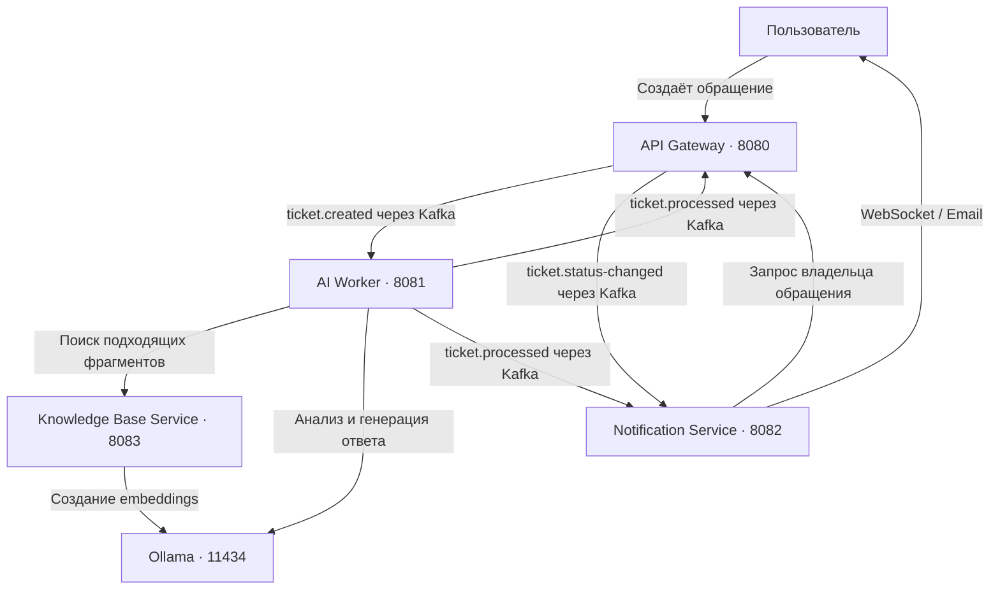

# Smart Helpdesk

**Система поддержки пользователей с автоматической обработкой обращений и базой знаний.**

Пользователь описывает проблему, а Smart Helpdesk определяет категорию и приоритет обращения, находит подходящие инструкции и готовит ответ с помощью локальной AI-модели. Если в базе знаний нет достаточно подходящей информации, обращение передаётся оператору. О результате пользователь узнаёт через уведомления.

Проект состоит из четырёх самостоятельных сервисов и общей библиотеки событий. Каждый сервис отвечает за свою часть работы и хранит данные в отдельной базе PostgreSQL. События между сервисами передаются через Kafka, а внутренние запросы выполняются по HTTP.

## Модули проекта

| Модуль | Для чего нужен | Адрес по умолчанию |
|---|---|---|
| [API Gateway](api-gateway/README.md) | Регистрация, вход, управление обращениями и сохранение результатов AI | `http://localhost:8080` |
| [AI Worker](ai-worker/README.md) | Анализ обращений, поиск контекста и генерация ответов | `http://localhost:8081` |
| [Notification Service](notification-service/README.md) | История уведомлений, доставка по WebSocket и дополнительный Email-канал | `http://localhost:8082` |
| [Knowledge Base Service](knowledge-base-service/README.md) | Статьи, категории и поиск информации для пользователей и AI | `http://localhost:8083` |
| [Common](common/README.md) | Общие форматы событий Kafka | Библиотека, отдельного порта нет |

Клиент обращается к API Gateway для работы с аккаунтом и тикетами, к Knowledge Base Service — для работы со статьями, к Notification Service — для получения уведомлений. AI Worker получает задания из Kafka.

## Как обрабатывается обращение



1. API Gateway сохраняет обращение и событие для отправки в Kafka.
2. AI Worker определяет категорию, эмоциональную окраску и приоритет сообщения.
3. Worker ищет в базе знаний фрагменты, близкие по смыслу к вопросу. Такой подход называется **RAG**: модель получает справочный материал перед подготовкой ответа.
4. При достаточной релевантности контекста модель формирует ответ. Иначе результат содержит признак необходимости участия оператора.
5. Gateway сохраняет результат в тикете, а Notification Service создаёт уведомление его владельцу.

Исходящие события сохраняются в БД вместе с изменениями — это паттерн **Transactional Outbox**. Отдельный процесс отправляет их в Kafka и повторяет попытку при временном сбое. Получатели учитывают идентификаторы уже обработанных событий, чтобы повторная доставка не создавала дубликаты данных.

## Технологии

| Технология | Роль в проекте |
|---|---|
| Java 21, Spring Boot 4.1 | Приложения и бизнес-логика |
| Maven | Общая сборка модулей |
| Spring Security, JWT | Аутентификация и разграничение доступа |
| PostgreSQL 16, Flyway | Хранение данных и миграции схемы |
| pgvector | Хранение embeddings и поиск по смыслу |
| Apache Kafka | Асинхронный обмен событиями |
| Ollama | Локальная генерация ответов и embeddings |
| WebSocket, STOMP | Доставка уведомлений подключённому клиенту |
| Docker Compose | Локальная инфраструктура |

## Порты и инфраструктура

| Компонент | Порт на компьютере | Назначение |
|---|---:|---|
| API Gateway | 8080 | HTTP API аккаунтов и обращений |
| AI Worker | 8081 | Служебный HTTP-интерфейс |
| Notification Service | 8082 | HTTP API и WebSocket |
| Knowledge Base Service | 8083 | HTTP API статей и внутренний поиск |
| PostgreSQL | 5432 | Базы `gateway`, `ai_worker`, `notification`, `knowledge_base` |
| Kafka | 9092 | Подключение приложений с компьютера |
| ZooKeeper | 2181 | Координация Kafka в локальном Compose |
| Kafka UI | 8090 | Веб-интерфейс Kafka |
| Ollama | 11434 | HTTP API локальных моделей |

Внутри сети Docker Kafka доступна по адресу `kafka:29092`. Сервисы и опубликованные порты Compose по умолчанию привязаны к `127.0.0.1`.

## Локальный запуск

Понадобятся **JDK 21**, **Maven**, **Docker Compose** и **Ollama**.

### 1. Поднять инфраструктуру

В корневом `.env` укажи `POSTGRES_PASSWORD`. Для стандартной локальной конфигурации приложений используется пароль `helpdesk`; если задаёшь другой, передай его также всем сервисам через `SPRING_DATASOURCE_PASSWORD`.

```shell
docker compose up -d
```

Compose запускает PostgreSQL с pgvector, Kafka, ZooKeeper и Kafka UI. Базы данных создаются автоматически при инициализации нового PostgreSQL-тома. Если том уже существует, недостающие базы нужно создать отдельно, сохранив имеющиеся данные. Приложения и Ollama запускаются отдельно.

### 2. Подготовить модели

При работающей Ollama загрузи модели:

```shell
ollama pull qwen3:4b
ollama pull nomic-embed-text
```

`qwen3:4b` используется для анализа и генерации текста, `nomic-embed-text` — для представления текста числовыми векторами. AI Worker и Knowledge Base Service должны использовать одну и ту же embedding-модель.

### 3. Настроить окружение

Настройки передаются через переменные окружения процесса или Run Configuration в IDE. Корневой `.env` читает Docker Compose; Java-приложения автоматически его не загружают.

| Переменная | Где используется | Назначение |
|---|---|---|
| `JWT_SECRET` | Gateway, Notifications, Knowledge Base | Общий ключ подписи и проверки access-токенов |
| `INTERNAL_API_KEY` | Все сервисы | Общий ключ внутренних HTTP-запросов |
| `AI_BASE_URL` | Worker, Knowledge Base | Адрес Ollama, по умолчанию `http://localhost:11434` |
| `AI_EMBEDDING_MODEL` | Worker, Knowledge Base | Embedding-модель, по умолчанию `nomic-embed-text` |
| `AI_MODEL` | Worker | Модель генерации, по умолчанию `qwen3:4b` |

Локальные значения по умолчанию позволяют запустить сервисы вместе. Для развёртывания используется профиль `prod` с внешними секретами и настройками сети: [руководство по конфигурации и доставке](docs/security-and-delivery.md).

### 4. Собрать и запустить приложения

Из корня репозитория:

```shell
mvn clean package -DskipTests
```

Каждую команду запуска выполни в отдельном терминале:

```shell
java -jar api-gateway/target/api-gateway-1.0.0-SNAPSHOT.jar
java -jar knowledge-base-service/target/knowledge-base-service-1.0.0-SNAPSHOT.jar
java -jar notification-service/target/notification-service-1.0.0-SNAPSHOT.jar
java -jar ai-worker/target/ai-worker-1.0.0-SNAPSHOT.jar
```

В IDE можно запустить соответствующие Spring Boot application-классы. Миграции Flyway применяются при старте каждого сервиса.

### 5. Начать работу

Зарегистрируй пользователя через Gateway и получи access-токен. Наполни базу знаний статьями с помощью аккаунта с ролью `ADMIN`, затем создай обращение через `POST /api/v1/tickets`. Результат обработки появится в тикете, а уведомление — в истории пользователя и его WebSocket-подписке.

## Структура репозитория

```text
smart-helpdesk/
├── api-gateway/             Аккаунты и обращения
├── ai-worker/               AI-обработка и RAG
├── notification-service/    Уведомления
├── knowledge-base-service/  База знаний
├── common/                  Контракты событий
├── docker/                  Инициализация инфраструктуры
├── docs/                    Техническая документация
├── scripts/                 Вспомогательные сценарии
├── docker-compose.yml       Локальная инфраструктура
└── pom.xml                  Родительская сборка Maven
```
